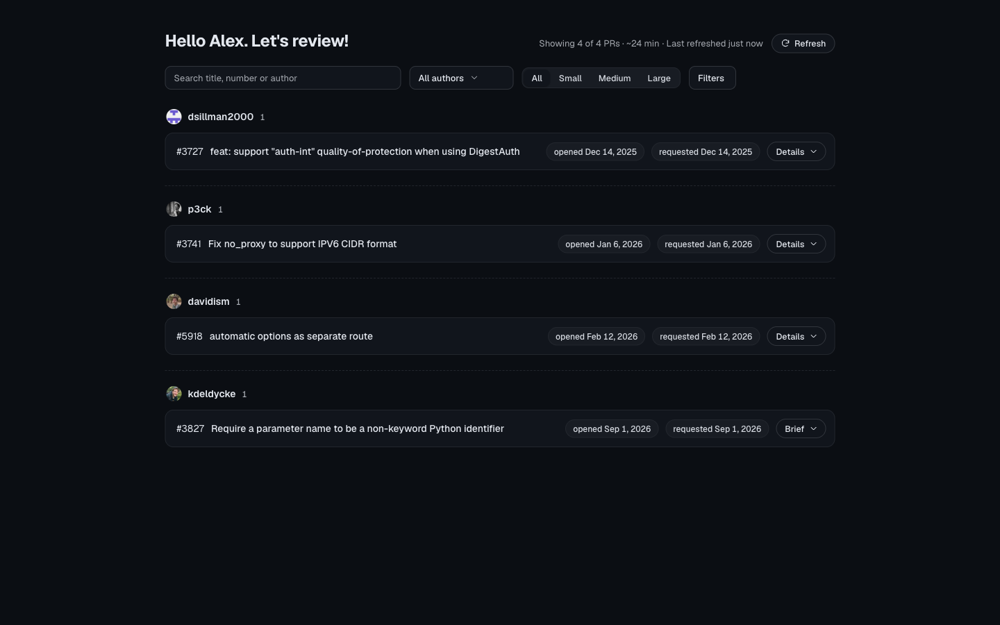
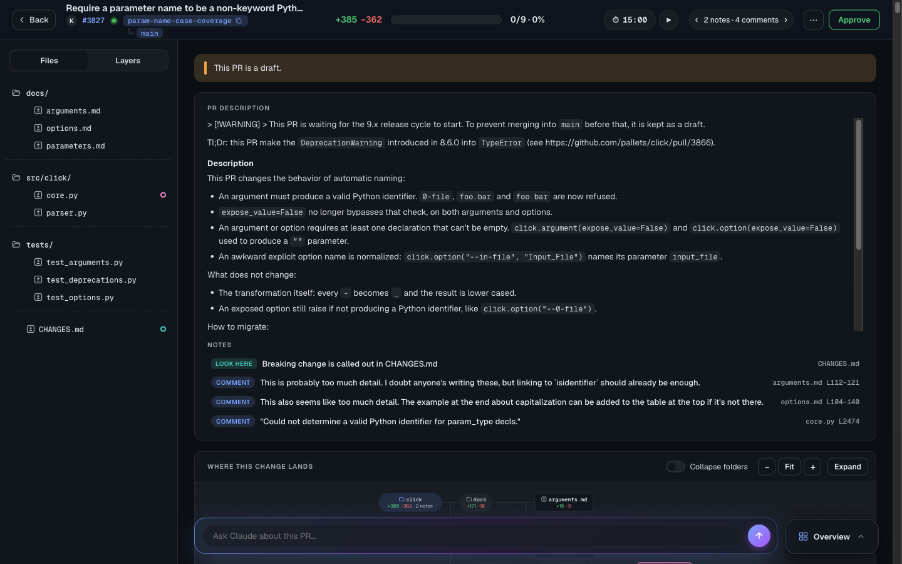
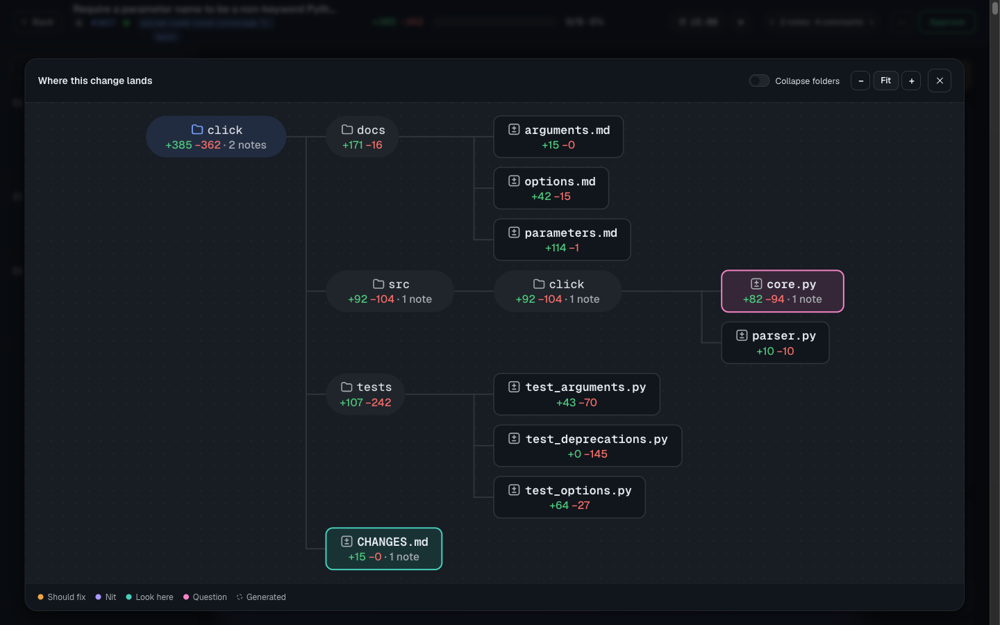
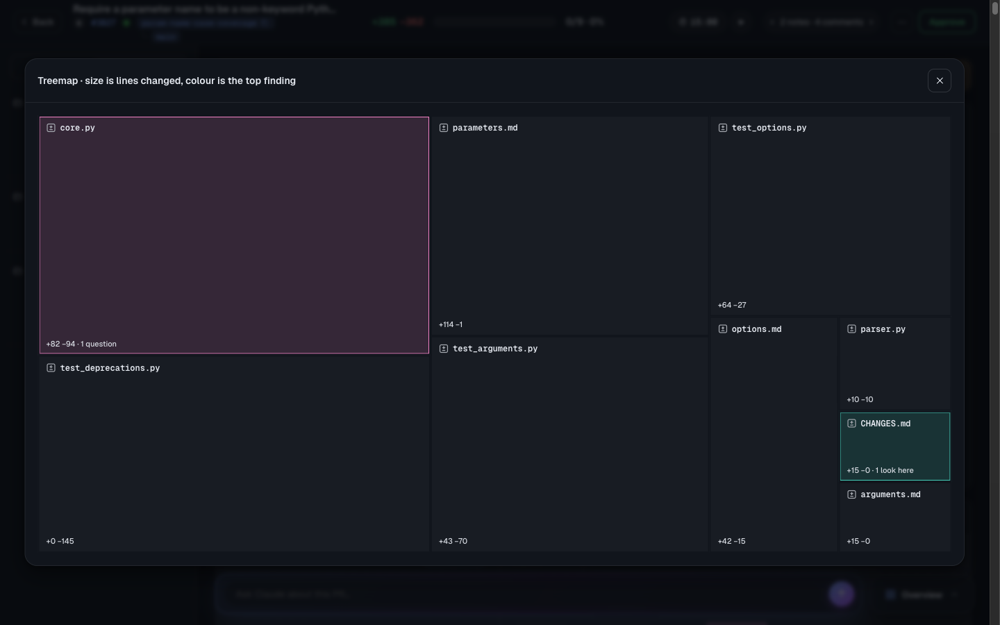
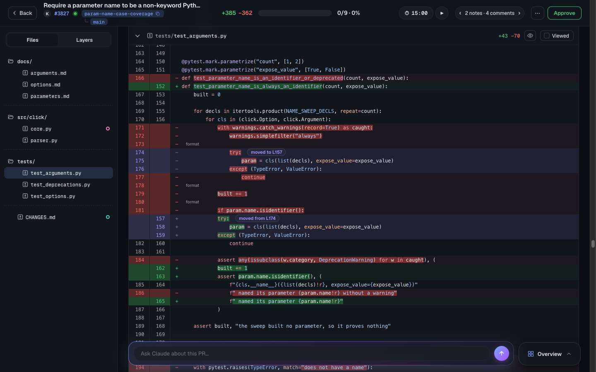
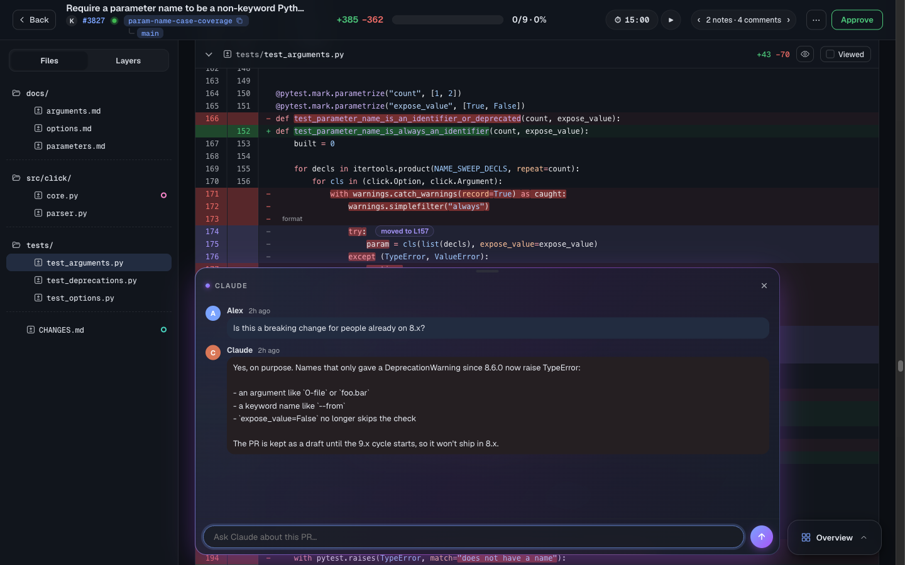

# AI review app

A local web app for reviewing GitHub pull requests fast, with an AI alongside you.

It builds one page per PR waiting on you: a map of where the change lands, every diff with moved and reformatted code marked, line comments that post to GitHub, and a chat with your AI. The AI is optional. It reads and writes plain files (see [CONTRACT.md](CONTRACT.md)), so any agent can plug in.

> Status: paused. The most useful parts (code tree, treemap) are moving into reusable review skills. This repo keeps the full app in case we pick it up again.



## What you get

| | |
|---|---|
| **Queue** (above): every PR waiting on you, grouped by author, with size and time estimates. | |
| **PR page**: description, AI notes and GitHub comments in one place. |  |
| **Code tree**: where the change lands, folder by folder, with lines changed and notes per file. |  |
| **Treemap**: file size is lines changed, colour is the top finding. |  |
| **Smart diff**: moved blocks link to each other, format-only lines are marked, changed tokens are highlighted. |  |
| **Chat**: ask your AI about the PR without leaving the page. |  |

Also: viewed-file tracking, a review timer, line comments that only post to GitHub when you tick "Post", and Approve.

## How to use

You need Python 3.9+ and the GitHub CLI (`gh`), signed in. No other dependencies.

1. Copy the config and set where to look for PRs:
   ```
   cp config.example.json config.json
   ```
   ```json
   {"sources": [{"owner": "your-org", "search": "review-requested:@me -author:@me"}]}
   ```
2. Run it:
   ```
   python3 review.py                  # build the queue, start the local helper, open it
   python3 review.py owner/repo#123   # one PR
   python3 review.py build --no-open  # rebuild pages only
   ```
3. Review in the browser. Comments, viewed files and ticks save locally. Nothing goes to GitHub unless you tick "Post" or press Approve.

The helper listens on `127.0.0.1` only and stops after 2 idle hours. Run `review.py` again to bring it back.

## Plug in an AI

The AI never talks to the app directly. It writes files and runs a few commands:

- **Summary and notes**: write `insights/<slug>.json`, then `review.py build`.
- **Answer your chat and comments**: watch `inbox.jsonl`, reply with `review.py ai reply <slug> <thread> "…"`.
- **Know what changed**: each refresh adds a line to `events.jsonl` (new PRs, new commits).

Full spec: [CONTRACT.md](CONTRACT.md).

## More

- [docs/details.md](docs/details.md): every config option, how saving works, the file layout.
- [DESIGN.md](DESIGN.md): how the pages are put together.
- Tests: `cd tests && python3 -m unittest`.

Screenshots use open PRs from public repos (pallets/click, pallets/flask, encode/httpx). The AI notes and chat in them are demo content.
